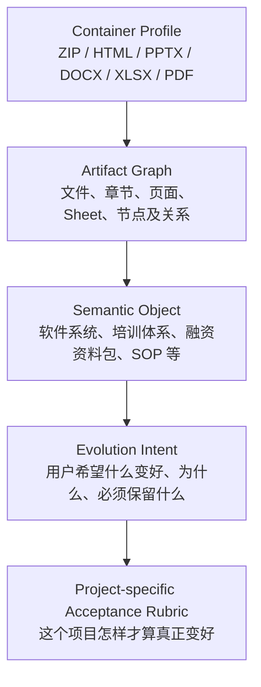
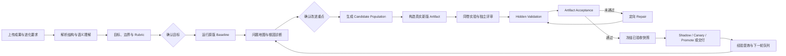

# Evolve Studio 系统设计思路

> 文档定位：说明 Evolve Studio 为什么这样设计、各功能解决什么问题，以及系统如何把“用户想让成果变好”转化为可执行、可验证、可交付的真实进化闭环。

## 1. 产品定义

Evolve Studio 是一个面向真实成果物的 AI 进化工作台。用户提供现有成果和改进意图，系统读取成果、建立目标、发现问题、生成多个真实新版、在相同条件下比较、验证未知场景，最后交付已经被验证过的同一份成果。

它服务的对象不局限于代码，也包括网页、Prompt、工作流、PPT、Word、表格、知识资料、ZIP 资料包，以及由多个文件共同组成的业务成果体系。

系统要解决的核心问题不是“让 AI 再写一版”，而是：

1. AI 是否真正读懂了上传成果及其业务含义；
2. AI 是否准确理解用户想改变什么、必须保留什么；
3. 修改是否作用在真实成果结构上；
4. 新版是否在可观察指标上优于原版；
5. 用户拿到的是否就是经过测试和验收的版本；
6. 一轮结果能否沉淀为下一轮更快、更准的经验。

因此，Evolve Studio 的本质是 **Artifact Evolution System（成果物进化系统）**，不是普通对话机器人、文案生成器或流程展示工具。

---

## 2. 核心设计理念

### 2.1 真实成果优先

上传文件是当前状态的事实来源，用户指令是进化方向的最高优先级。系统不能只根据文件名、摘要或扩展名想象成果，也不能把建议文字当作已经完成的改进。

每个关键结论都要能够回答：

- 读了哪份成果；
- 在哪里发现了什么；
- 为什么要修改这里；
- 修改后如何影响用户目标；
- 用什么证据证明它更好。

### 2.2 先理解，再进化

系统在生成方案前，先形成一份可核对的“意图模型”：

- 用户明确要求；
- 从成果类型推导出的必要要求；
- 必须保护的内容和行为；
- 尚未确认的假设；
- 可观察的验收结果。

只有当目标、边界和验收标准形成一致契约后，才允许进入测试和修改，减少“AI 做得很多，但方向不对”。

### 2.3 问题与根因分离

“导航不清楚”是问题，“信息架构使用技术模块命名，和新手任务心智不一致”才是可能的根因。

问题来自用户可观察的结果，根因必须同时包含证据、反证和可证伪条件。这样生成的 Candidate 才是在验证一个因果假设，而不是随机改版。

### 2.4 Candidate 必须是真实新版

Candidate 不是一组改进建议，而是完整、可执行或可交付的成果快照。实验、隐藏验证和最终验收都围绕该快照进行。

```text
错误方式：修改建议 → 给建议打分 → 重新生成交付物
正确方式：修改假设 → 生成真实新版 → 运行新版 → 验收同一新版 → 冻结并交付
```

### 2.5 测试版本等于交付版本

通过验证的 Candidate 会被冻结。成果中心只能交付这份冻结快照，不能在下载时让 AI 临时再生成一次，从机制上避免“测试的是 A，交付的是 B”。

### 2.6 不确定性必须可见

系统严格区分：

- `VERIFIED`：有真实执行或结构证据；
- `PARTIAL`：只验证了部分范围；
- `UNVERIFIED`：缺少 Runner、截图或外部环境；
- `FAILED`：已有证据证明未通过。

没有浏览器、构建环境或原生渲染器时，系统应显示“未验证”，不能用语言模型模拟结果冒充真实通过。

### 2.7 复杂能力隐藏在简单操作后面

普通用户只需要理解五件事：看懂、找差距、生成新版、验证提升、领取成果。底层可以保留复杂的解析、检索、实验、Gate、发布和经验体系，但不应要求用户先理解工程术语才能完成任务。

---

## 3. 系统如何理解上传成果

Evolve Studio 使用四层对象模型，避免把文件格式误认为业务对象。



### 3.1 Container Profile：识别物理容器

这一层回答“上传的是什么格式、能否解包、能否编辑、能否保持原格式”。它只决定技术处理方式，不决定业务目标。

例如 ZIP 只是容器。只有内部文件、结构和用户意图共同证明它是软件工程时，系统才把它识别为代码库；它也可能是投融资资料包或培训资源包。

### 3.2 Artifact Graph：理解组成和依赖

系统将成果展开为结构化图谱：

- ZIP 中的目录、文件、模块与依赖；
- PPT 中的页面和文本块；
- Excel 中的 Sheet、单元格、公式和引用；
- DOCX 中的文档部件和文本位置；
- 工作流中的节点、边、状态和异常路径；
- 多文件之间的引用、依赖和一致性约束。

这使系统可以在正确位置修改内容，并在多成果项目中检查跨文件一致性。

### 3.3 Semantic Object：判断成果在业务上是什么

系统结合文件名、内部结构、正文、上下游关系、目标受众和用户命令，推断成果的业务类型、用途、主要组件和成功条件。

语义对象决定“应该怎样理解好坏”，例如：

| 进化对象 | 重点标准 |
| --- | --- |
| 网页 / 软件 | 功能、交互、构建、回归、可用性 |
| SOP / 文档 | 结构、易理解性、步骤完整性、可执行性 |
| PPT | 页面覆盖、叙事逻辑、视觉层级、可编辑性 |
| 表格 | 数据完整、公式正确、业务可用、Sheet 关系 |
| 工作流 | 节点、状态、异常路径、输入输出契约 |
| Prompt | 指令清晰、输出契约、鲁棒性、边界处理 |
| 多文件资料包 | 单文件质量与跨文件事实一致性 |

### 3.4 Evolution Intent：编译用户真实意图

系统把自然语言要求编译成：目标变化、保护项、输出要求、质量优先级和验收观察点。用户要求始终高于默认行业标准；行业标准负责补齐用户未说明但交付必须满足的底线。

### 3.5 长成果的读取策略

系统保留完整原文作为 Source Asset，但不会在每个节点重复发送全文。它会根据当前任务生成 `readFocus`，从完整成果中检索最相关的章节、文件、页面、单元格或节点，同时保留原始位置。

这种方式兼顾三点：

- 原始成果不被截断；
- 每一步读取与当前问题直接相关；
- 控制上下文体积，提高速度和准确度。

---

## 4. 三层流程结构

### 4.1 用户层：五个任务步骤

| 用户步骤 | 用户要回答的问题 | 核心产出 |
| --- | --- | --- |
| 1. 理解材料与目标 | 系统读懂了什么？我要什么变好？ | 意图模型、目标、边界、验收标准 |
| 2. 找出改进重点 | 当前最值得改的是什么？为什么？ | Baseline、问题地图、根因诊断 |
| 3. 自动生成新版 | 哪些真实新版更有机会解决根因？ | Candidate Population、实际新版文件、实验 Winner |
| 4. 检查改进效果 | 新版是否真的更好，未知场景是否稳定？ | Hidden Validation、Artifact Acceptance、修复结果 |
| 5. 交付与继续进化 | 最终拿到什么？下一轮改什么？ | 冻结成果、版本、发布结果、经验与下一轮队列 |

### 4.2 语义层：六个自适应阶段

系统内部保留六个固定位置：定义、建模、诊断、进化、验证、交付。每个位置的中文名称、输入、动作、产出和完成条件会根据语义对象自动调整。

例如 SOP 可以显示为“明确读者目标 → 建立内容地图 → 找出理解断点 → 重组表达与导航 → 新手任务验证 → 网页交付”；软件项目则可以显示为“需求契约 → 工程体检 → 缺陷定位 → 构建候选 → 测试验收 → 工程交付”。

### 4.3 工程层：八阶段、二十三个节点

运行记录保留全部可审计节点，包括目标契约、Baseline、Trace、问题聚类、根因、Candidate、Sandbox、独立评审、Hidden Holdout、Artifact Acceptance、Repair、Shadow、Canary、经验沉淀和下一轮队列。

这层主要服务高级用户、研发排障和治理审计，不作为普通用户的主导航。

---

## 5. 端到端进化闭环



### 5.1 理解与契约

系统先展示原始要求、AI 理解、隐含要求、假设、保护项和验收标准。用户确认后，目标函数被冻结，后续节点不能自行改变目标。

项目专属 Rubric 由三部分组成：

```text
用户明确意图
+ 该业务对象的专业成功标准
+ 成果格式与结构完整性
= Project-specific Acceptance Rubric
```

每条标准包含权重、最低分、是否为 Hard Gate、需要什么证据、适合哪种验证方式。Hard Gate 失败不能被其他高分平均掉。

### 5.2 Baseline：先测原版

Baseline 用统一测试集测量当前版本，记录输出、延迟、成本、Trace 和证据状态。它建立改进前基线，使后续判断依据“同一条件下是否提升”，而不是依赖主观印象。

### 5.3 问题地图与根因

系统将失败按共同表现聚类，结合频率、影响、严重度、证据可信度和可修复性排序，每轮只聚焦一个高价值问题。

根因诊断必须包含：

- 当前观察到的问题；
- 对应的实现或内容原因；
- 支持证据与反证；
- 置信度；
- 能推翻该判断的可观察条件。

### 5.4 Candidate Population：并行探索多个假设

系统不会只生成一个答案，而是构造一组差异化 Candidate，例如局部优化、结构重组、工具增强、记忆增强、跨经验复用和探索型方案。

每个 Candidate 都包含：

- 修改机制；
- 对应的源成果证据；
- 与用户要求的对应关系；
- 真实修改位置与内容；
- 预期影响和风险；
- 覆盖的验收标准；
- 证伪条件。

### 5.5 Artifact Builder：把方案变成真实新版

系统优先使用本地确定性构造：精确文本替换、JSON Path、Markdown Section、代码文件 Overlay 等。这类修改快、可复现，并能逐字节保留未修改内容。

无法确定性修改时，由 Artifact Builder 按成果原生结构构造：

- 长 HTML/Text 使用小型精确编辑，不重写全文；
- ZIP 在原包基础上回写已知文件；
- PPTX 按页面与文本块回写；
- DOCX 按 OOXML 部件与文本位置回写；
- XLSX 按 Sheet、单元格和公式回写。

构造完成后必须经过文件生成和结构核对，失败会保留具体原因，并在可修复时自动重试一次。

### 5.6 Candidate 实验与独立评审

所有候选在同一 Baseline、测试条件和运行环境中比较。生成模型和评审模型可以分离，降低“自己生成、自己偏爱”的风险。

自适应模式使用快速预筛与 Finalist 机制，把更多算力投入最有希望的候选；完整模式则允许所有 Candidate 运行全量测试。

### 5.7 Hidden Validation：防止只会已知题

实验 Winner 还不是最终成果。系统使用 Candidate 生成时不可见的测试检查泛化、稳定性和回归风险，并与原版在同一套盲测卷上比较。

### 5.8 Artifact Acceptance 与 Repair Loop

Hidden Validation 通过后，系统继续检查最终成果本身：

- 用户要求覆盖度；
- 内容和结构完整性；
- 与原版相比是否真实提升；
- 保护项是否保持；
- Hard Gate 是否全部通过；
- 文件能否按原格式正确生成。

未通过时只针对失败项修复，并重新运行 Hidden Validation 和成果验收。达到修复次数上限仍未通过，则返回重新规划，不能带病交付。

### 5.9 冻结、交付与线上验证

通过验收的快照被冻结并进入成果与版本。若项目连接真实运行环境，可以继续进行 Shadow、Canary 5% → 20% → 50%、Promote 或 Rollback；普通文档和离线成果则可直接下载已验收版本。

### 5.10 经验沉淀与下一轮

系统综合离线实验、Hidden、成果验收和线上证据，将结果沉淀为：

- Success Pattern；
- Failure Pattern；
- 可复用 Skill；
- Anti-pattern；
- 适用条件和限制；
- 下一轮待解决问题。

只有证据充分的经验才可登记为可复用 Skill，避免把偶然胜出固化为错误规律。

---

## 6. Gate 设计

Gate 不是为了增加操作，而是防止错误结果继续向下游传播。实际顺序为 **A → B → C → F → D → E**。

| Gate | 判断问题 | 阻止的风险 |
| --- | --- | --- |
| A · Problem Worthy | 这个问题值得开启一轮进化吗？ | 为低价值或证据不足的问题浪费资源 |
| B · Root Cause Ready | 根因证据足够可信吗？ | 根据错误原因生成大量无效改动 |
| C · Offline Winner | 完整 Candidate 在隐藏验证中胜出吗？ | 把只适应已知题的版本当成 Winner |
| F · Artifact Ready | 最终成果本身完整满足目标吗？ | 测试通过但文件残缺、格式错误或要求漏项 |
| D · Online Stable | 真实流量下稳定吗？ | 离线优秀但线上退化 |
| E · Experience Ready | 经验值得跨项目复用吗？ | 把偶然结果错误沉淀成通用能力 |

目标确认、实验范围确认和真实发布属于人工 Gate。自动运行可以连续推进机器节点，但不会越过这些关键决策。

---

## 7. 主要功能模块及作用

### 7.1 工作台

展示项目、当前阶段、待处理动作和进化结果概况，让用户快速回到需要决策的位置。

### 7.2 我的进化项目

管理每个成果的独立目标、材料、模型配置、实验状态、版本、运行记录和自动进化策略。

### 7.3 材料与证据

负责上传、粘贴、替换材料，查看解析质量、完整原文、结构索引、Artifact Graph、截图证据及 Runner 连接能力。这里回答“系统实际能读到什么”。

### 7.4 目标与进化

承载五步主流程：确认意图和标准、建立 Baseline、诊断问题、生成 Candidate、验证与交付。它是普通用户完成一轮进化的主要入口。

### 7.5 成果与版本

查看原版、实验 Winner、Search Champion、冻结成果和历史版本，支持比较、下载和回滚。这里强调版本血缘和“已验收才可交付”。

### 7.6 运行记录

展示工程阶段、23 个节点、Gate 状态、输入输出、耗时、模型路由、失败原因和下一步。主要用于审计、排障和理解系统为何作出当前结论。

### 7.7 自动续跑设置

设置多轮进化的候选数量、探索比例、停止条件、预算、定时任务和自动推进策略。自动模式在人工 Gate 前暂停，保留用户控制权。

### 7.8 问题中心

跨项目汇总高价值问题、严重度、证据和处理状态，帮助团队确定进化优先级。

### 7.9 进化实验室

集中查看 Candidate Population、实验结果、Winner、失败方案、Archive 和版本血缘，支持比较不同进化机制的效果。

### 7.10 发布中心

管理 Shadow、Canary、Promote 和 Rollback，要求离线验证、Artifact Ready 和线上证据形成连续链路。

### 7.11 经验中心

将经过多层验证的结果登记为 Skill、Lesson 或 Anti-pattern，记录适用条件、证据和限制，供后续项目复用。

### 7.12 成果中心

集中展示 Best-Ever Search Champion 和已经通过 Gate F 的成果文件。默认可包含主成果、Patch Bundle、Scorecard、Manifest、Lineage、Release Notes 和 Search Summary。

### 7.13 模板中心

保存可复用的目标、Rubric、测试、工作流和项目配置，降低同类项目重复配置成本。

### 7.14 AI 模型与连接

配置不同供应商和模型，并按操作分配生成、构造、评审、视觉判断等职责。支持备用路由、健康记忆、延迟统计和失败切换。

### 7.15 Evolve Copilot

读取当前项目状态和证据，用中文解释当前结论、推荐下一步并触发低风险流程动作。它是辅助入口，不替代主流程和人工 Gate。

---

## 8. 速度与准确度设计

### 8.1 提高速度

- 按步骤检索相关上下文，避免重复发送全文；
- 确定性 Patch 和 ZIP Overlay 优先，减少 AI 重写；
- Candidate 预筛与 Finalist 分层投入算力；
- 同一 Candidate 的多道测试批量执行，复用上下文；
- AI 请求并发池避免过载和浏览器连接拥塞；
- 相同输入使用受控缓存；
- 模型健康与延迟记录帮助路由到更稳定的连接；
- 运行进度显示当前阶段、百分比、耗时和预计剩余时间。

### 8.2 提高准确度

- 用户命令、原始成果和保护项共同形成不可漂移的目标契约；
- 每条验收标准绑定测试与证据范围；
- 问题、根因、建议和真实改动分层记录；
- Candidate 要求完整因果链和证伪条件；
- 生成与评审模型可分离；
- 可见测试与 Hidden Holdout 分离；
- 完整性、相对提升和 Hard Gate 单独检查；
- 不具备真实证据时明确标记 `UNVERIFIED`；
- 交付冻结快照，消除验证后再次生成带来的漂移。

### 8.3 失败恢复

每个运行节点保留状态、耗时和错误。页面切换不会丢失正在运行的任务；刷新后可以根据检查点续跑。单道测试失败可以只补考失败题；Candidate 构造失败会保留逐候选原因；Artifact Acceptance 失败进入定向 Repair；线上指标异常则回滚。

---

## 9. UI 与 UX 原则

1. **中文任务语言优先**：界面先说明用户要完成什么，英文术语作为次级标签。
2. **当前动作优先**：首屏突出当前阶段、进度、关键结论和下一步，完整工程路径按需展开。
3. **渐进披露**：默认展示结论，证据、完整标准和技术 Trace 可展开查看。
4. **减少重复**：同一目标、状态和说明只保留一个主展示位置。
5. **状态可恢复**：切换页面、刷新或暂停后，用户仍能看到真实运行位置。
6. **失败可行动**：错误说明失败对象、失败阶段、具体原因和可执行的恢复方式。
7. **高影响动作显式确认**：冻结目标、真实流量发布和回滚保持清晰的人机边界。
8. **证据靠近结论**：用户无需在多个页面之间寻找“AI 为什么这样判断”。

---

## 10. 系统的关键不变量

无论未来增加何种成果类型、模型或运行方式，以下规则都应保持不变：

1. 用户意图是最高优先级；
2. 完整 Source Asset 必须保留；
3. 文件格式不等于业务对象；
4. 问题必须有证据，根因必须可证伪；
5. Candidate 必须落成真实成果；
6. Winner 必须完成全量实验与 Hidden Validation；
7. Hard Gate 失败不能被平均分掩盖；
8. 缺少真实验证能力必须显示未验证；
9. 测试、验收和交付必须指向同一冻结快照；
10. 最佳版本由证据决定，不能默认把最后一轮当成最好一轮；
11. 自动化不能越过人工决策和真实发布边界；
12. 每轮结果都应进入经验与下一轮反馈闭环。

---

## 11. 一次理想的用户体验

用户上传一份成果并写下“希望它怎样变好”。系统先说明自己识别到了什么、哪些地方不确定，以及准备用什么标准判断改进。用户确认后，系统测试原版，指出最值得解决的问题及其根因。随后生成几个机制不同的真实新版，并显示构造和测试进度。

实验完成后，系统说明哪个版本胜出、提升发生在哪些指标、还有哪些风险。Winner 再经过未知场景和成果完整性验收；未通过的项目被自动定向修复。最终用户下载的文件与被验证的文件完全一致，并能看到版本来源、改动依据和验证证据。系统把本轮成功与失败规律带入下一轮，使后续进化更快、更准。

这就是 Evolve Studio 的最终设计目标：**让 AI 对真实成果负责，让每次“变好”有目标、有证据、有成品、有验证，也有下一轮。**
